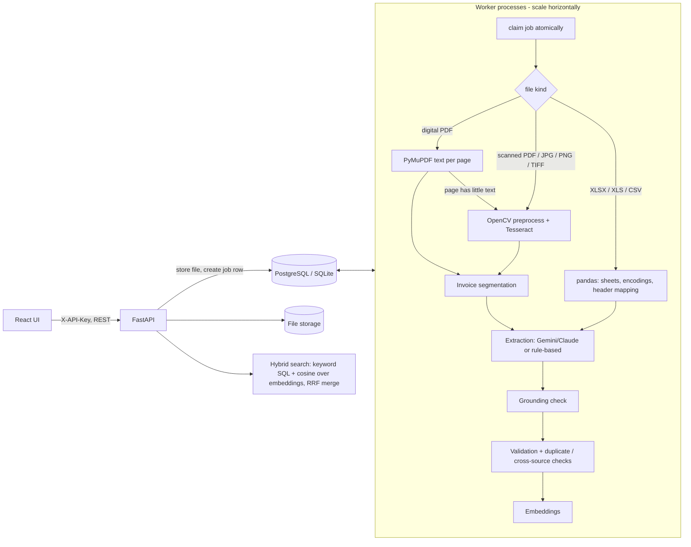

# Architecture

## Request lifecycle
1. `POST /documents` streams each file to disk (size-limited), detects type by **magic bytes**, hashes it (SHA-256), inserts a `documents` row with `status=queued` and returns immediately (202).
2. A worker claims the row with an atomic conditional `UPDATE ... WHERE status='queued'` (safe with many workers). The DB *is* the queue, so jobs survive restarts; stale `processing` jobs are re-queued after 15 min.
3. Reading -> segmentation -> extraction -> grounding -> validation -> embedding. Progress (`stage`, `pages_done/pages_total`, `progress`) is committed as it goes and polled by the UI.
4. Failures: corrupt/unsupported input = permanent `failed` with a message; unexpected/transient errors = retry with exponential backoff (max 3 attempts), then `failed`. `POST /documents/{id}/reprocess` re-queues.
5. Final status: `completed` (no errors) or `needs_review` (any error-severity issue, ungrounded or low-confidence field).

## Design decisions
| Decision | Rationale | Trade-off |
|---|---|---|
| Python/FastAPI | OCR, pandas, LLM SDKs are all Python; no cross-language glue | |
| DB-backed queue (not Redis/BullMQ) | Fewer moving parts, durable, atomic claim works on Postgres and SQLite, easy to scale workers | Polling latency ~0.5 s; Redis/Celery is better above thousands of jobs/min |
| LLM optional + rule-based fallback | System works (and is testable) without paid API; rules are also the evaluation baseline | Rules are layout-sensitive; LLM recommended for production |
| Grounding check in code | Guarantees "no invented values": every extracted value must be traceable to the source text, otherwise nulled + flagged | May discard correct values the OCR garbled (flagged for review instead) |
| Original AI output kept in `ai_data`; edits in `corrections` | Audit trail, measurable AI accuracy vs human fixes | |
| Embeddings stored as JSON, cosine in Python; default embedder is hashed token/char-n-gram | No extra service, deterministic, works offline | Not truly semantic by default; set `EMBEDDING_MODEL` (sentence-transformers) for real semantics, and move to pgvector/ANN beyond ~100k chunks |

## Security
API key (constant-time compare) + per-key/IP rate limit; CORS allow-list; magic-byte type validation; size and page limits; sanitised filenames, random storage names (no path traversal); parameterised ORM queries; security headers; non-root container; document text is treated as untrusted in the prompt and LLM output is schema-constrained + grounded. **Not implemented:** per-user auth/RBAC, antivirus scanning, encryption at rest, TLS termination (put behind a reverse proxy).
