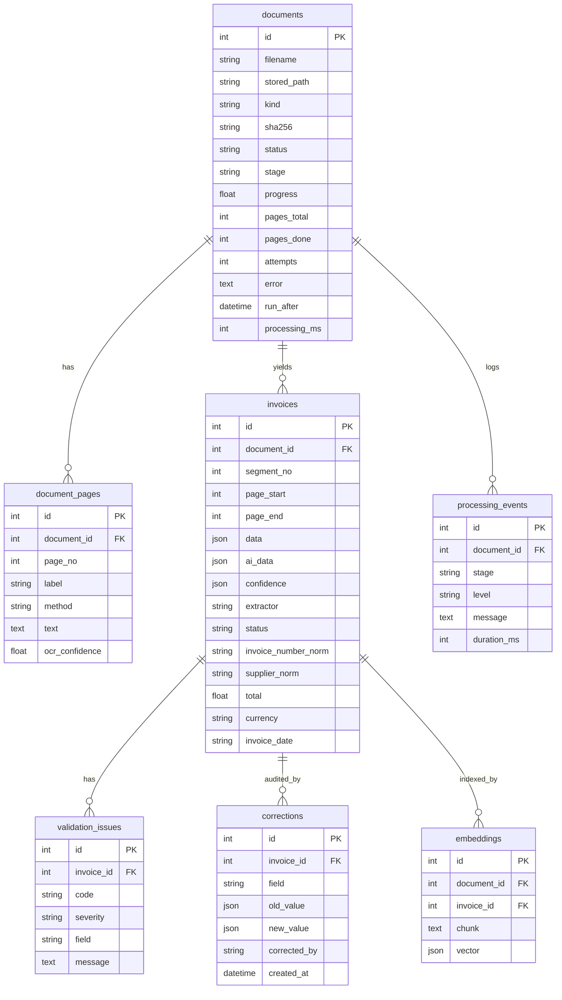

# Database schema (SQLAlchemy models in `backend/app/models.py`)

Indexes: `documents(status, sha256)`, `invoices(document_id, status, invoice_date, invoice_number_norm, supplier_norm)`, composite `(supplier_norm, invoice_number_norm)` for duplicate detection, FKs on all child tables (`ON DELETE CASCADE`).

**Scaling notes:** on PostgreSQL, switch `embeddings.vector` to `pgvector` `vector(N)` with an HNSW index and replace the Python cosine loop in `/search` with `ORDER BY vector <=> :q`; add a `tsvector` GIN index on `invoices.source_text` for full-text keyword search (currently `ILIKE`).

**Validation codes:** MISSING_FIELD, INVALID_NUMBER, INVALID_DATE, INVALID_CURRENCY, LINE_MISMATCH (qty x price != line total), SUBTOTAL_MISMATCH (sum of lines != subtotal), TOTAL_MISMATCH (subtotal + tax != total), DUPLICATE_INVOICE, DUPLICATE_FILE, CROSS_SOURCE_MISMATCH (same invoice in another PDF/sheet with different values), UNGROUNDED_FIELD, LOW_CONFIDENCE.
